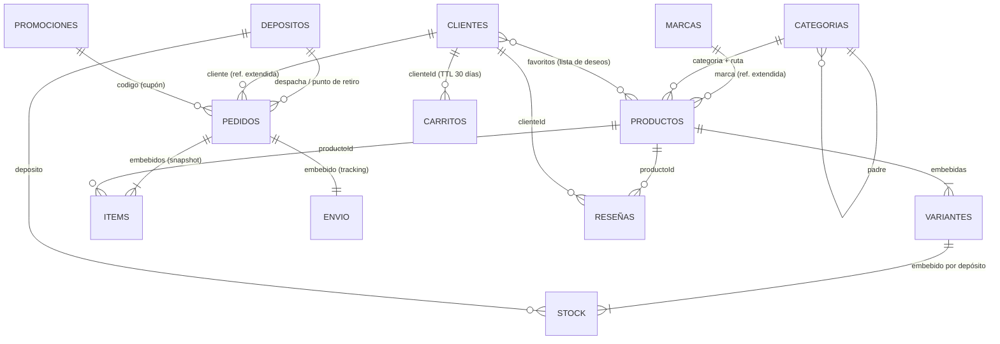

# 2. Modelo de datos

Base: **`mparfum`**, el e-commerce de perfumería y cosmética. Tiene 9 colecciones y 3 vistas.



## Colecciones

| Colección | Contenido | Docs (carga base) |
|-----------|-----------|-------------------|
| `marcas` | Marcas (Chanel, Dior, La Roche-Posay, M·A·C, Kérastase...) con los rubros que venden | 27 |
| `categorias` | Árbol de 3 niveles: Fragancias, Maquillaje (Rostro / Ojos / Labios / Uñas), Tratamiento, Cuerpo y baño, Cabello, Sets de regalo | 26 |
| `depositos` | 3 depósitos con stock y 6 puntos de retiro, con ubicación GeoJSON | 9 |
| `productos` | Perfumes y cosméticos con variantes y stock por depósito embebidos | 50 |
| `clientes` | Datos personales, direcciones de envío, preferencias, favoritos y club de puntos | 2.000 |
| `pedidos` | Compras web y app: ítems, pago, cupón, envío con tracking e historial de estados | 20.000 (configurable) |
| `reseñas` | Puntaje y comentario por cliente y producto (compra verificada) | ~3.800 |
| `promociones` | Cupones y promociones por categoría, marca, canal o medio de pago | 6 |
| `carritos` | Carritos abiertos del sitio y la app | 300 |

Vistas:

- `v_catalogo_publico`: lo que consume el front-end, sin stock interno;
- `v_ventas_diarias`: para el analista, sin datos personales;
- `v_stock_por_deposito`: para logística.

## Decisiones de diseño: embeber o referenciar

| Relación | Decisión | Motivo |
|----------|----------|--------|
| Producto → variantes | **Embebido** | La ficha del producto siempre las muestra juntas. Son pocas (de 1 a 4) y no tienen vida propia. |
| Variante → stock por depósito | **Embebido** | Hay 3 depósitos (cantidad acotada). Así el stock se reserva en una operación atómica sobre un solo documento. |
| Producto → marca | **Referencia extendida** (`{_id, nombre}`) | El listado muestra el nombre sin hacer `$lookup`. La marca casi nunca cambia de nombre. |
| Producto → categoría | **Referencia + ruta materializada** (`categoria.ruta`) | Permite traer todo "Maquillaje" con una igualdad indexada, sin recorrer el árbol. |
| Pedido → ítems | **Embebido con snapshot** de nombre y precio | El pedido tiene que reflejar el precio *al momento de la compra*, aunque después cambie el precio del catálogo (ver C26). |
| Pedido → envío | **Embebido** (tipo, empresa, tracking, dirección o punto de retiro) | Es parte del pedido. La dirección se copia porque el cliente puede cambiarla después. |
| Pedido → cliente | **Referencia extendida** (`_id`, nombre, email, provincia) | Los reportes por provincia no necesitan `$lookup`. |
| Cliente → favoritos | **Array de referencias** (`ObjectId`) | La lista de deseos es acotada. Con un índice multikey se puede saber cuántos clientes desean un producto (C21). |
| Producto ↔ reseñas | **Referenciado** (colección aparte) | Las reseñas crecen sin límite y embeberlas haría crecer el documento sin control (límite de 16 MB). |
| Rating del producto | **Patrón computed** (`rating.promedio`, `rating.cantidad`) | Se recalcula con `$merge` (C27) en lugar de calcularlo en cada carga del catálogo. |
| Carritos | **Colección aparte con TTL** | Son datos temporales. Los que quedan inactivos 30 días se eliminan solos. |
| Categorías | **Árbol con referencia al padre** | Admite `$graphLookup` (C15) para armar el menú del sitio. |

## Patrón polimórfico en `productos`

Todos los productos comparten `nombre`, `tipo`, `marca`, `categoria`, `variantes`, `rating` y `activo`. Lo específico de cada tipo va en **`atributos`**:

```js
// tipo: "fragancia"
atributos: {
  concentracion: "Eau de Parfum",
  familiaOlfativa: "oriental vainilla",
  notas: { salida: ["pera", "pimienta rosa"], corazon: ["café", "jazmín"], fondo: ["vainilla", "pachulí"] },
  perfumista: "...", lanzamiento: 2014
}
// tipo: "maquillaje"
atributos: { zona: "rostro", acabado: "mate", cobertura: "alta", duracionHoras: 24, fps: 10, tipoPiel: ["mixta", "grasa"] }
// tipo: "tratamiento"
atributos: { tipoPiel: ["sensible"], fps: 50, beneficios: [...], ingredientesClave: ["Mexoryl 400"] }
```

## Ejemplo de documento: `productos`

```js
{
  _id: ObjectId("..."),
  nombre: "Sauvage",
  tipo: "fragancia",
  genero: "hombre",
  marca: { _id: "dior", nombre: "Dior" },
  categoria: { _id: "fragancias-hombre", ruta: ["fragancias", "fragancias-hombre"] },
  descripcion: "Eau de Toilette de Dior, familia aromática fougère...",
  etiquetas: ["aromática fougère", "eau de toilette", "hombre", "fresco"],
  atributos: { concentracion: "Eau de Toilette", familiaOlfativa: "aromática fougère", notas: {...}, perfumista: "François Demachy", lanzamiento: 2015 },
  variantes: [
    { sku: "FR-1037", presentacion: "Eau de Toilette 60 ml", contenido: { valor: 60, unidad: "ml" },
      precio: 139800, precioLista: 139800,
      stock: [ { deposito: "DEP-MZA", cantidad: 84 }, { deposito: "DEP-CBA", cantidad: 31 }, { deposito: "DEP-BA", cantidad: 12 } ] },
    { sku: "FR-1038", presentacion: "Eau de Toilette 100 ml", ... },
    { sku: "FR-1039", presentacion: "Eau de Toilette 200 ml", ... }
  ],
  rating: { promedio: 4.07, cantidad: 198 },
  activo: true,
  fechaAlta: ISODate("2024-01-12")
}
```

## Ejemplo de documento: `pedidos`

```js
{
  numero: 100003,
  cliente: { _id: ObjectId("..."), nombre: "...", email: "...", provincia: "San Juan" },
  fecha: ISODate("2026-07-16T23:25:35Z"),
  canal: "web",                       // web | app
  deposito: "DEP-MZA",                // depósito regional que despacha
  items: [
    { productoId: ObjectId("..."), sku: "FR-1046", nombre: "Acqua di Giò - Eau de Toilette 50 ml",
      marca: "Giorgio Armani", tipo: "fragancia", categoria: "fragancias-hombre", cantidad: 1, precioUnitario: 81300 }
  ],
  subtotal: 81300, descuento: 8100, total: 79700,
  promocion: "BIENVENIDA10",
  pago: { medio: "credito", cuotas: 6 },
  envio: { tipo: "domicilio", costo: 6500, empresa: "Andreani", tracking: "AND0000100003",
           direccion: { calle: "...", ciudad: "San Juan", provincia: "San Juan", cp: "5400" } },
  // o bien: envio: { tipo: "retiro", puntoRetiro: "PR-MZA-CENTRO", costo: 0 }
  estado: "entregado",
  historialEstados: [ { estado: "pendiente", fecha: ... }, { estado: "pagado", fecha: ... }, ..., { estado: "entregado", fecha: ... } ]
}
```

## Validación del esquema

Cada colección tiene un validador `$jsonSchema` (script 00) que exige:

- los campos obligatorios;
- los enumerados: `tipo`, `genero`, `canal` (web o app), `estado`, `envio.tipo`, `pago.medio`, `club.nivel` y el tipo de depósito;
- los rangos: precio ≥ 0, puntaje entre 1 y 5, cuotas entre 1 y 12, stock ≥ 0;
- los formatos de email y DNI, y el GeoJSON `Point`.

En la consulta C28 se ve cómo se rechaza un documento inválido (error 121, *Document failed validation*).
